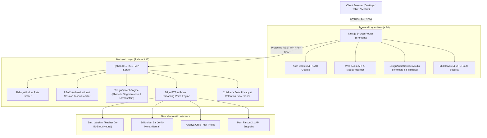

# System Architecture & Technical Specification
## Every Child Reads (ప్రతి బిడ్డ చదవాలి) – Telugu AI Assessment SaaS
**Architecture Version:** 3.2-Enterprise | **Tech Stack:** Next.js 14, Python 3.12, Edge-TTS, Docker  

---

## 1. High-Level Architecture Overview

---

## 2. Component Design & Responsibilities

### 2.1 Frontend Architecture (`frontend/src/`)
- **`src/app/` (Next.js 14 App Router):**
  - `/login`: Secure email & password portal selection login (no exposed credentials, no OTP in password field).
  - `/admin`: Administrative oversight, school registry, teacher management, student records, and AI calibration.
  - `/teacher`: Classroom student roster, live test execution, teacher review sign-offs.
  - `/reading-studio`: Large typography reading canvas, real-time waveform visualizer, multi-grade passage catalog.
  - `/tutor`: Conversational Telugu AI reading tutor with live voice dialogue, contrast feedback, and slow syllable repetition.
  - `/parent`: Parent dashboard with reading trajectory curves, audio recording playback, and home learning tips.
  - `/practice`: Akshara Sadhana flashcard drills with confetti rewards.
  - `/assessment-result`: Syllable-level diagnostic matrix, teacher verification notes.
  - `/student-profile`: 12-week WCPM trajectory and print-ready reading certificates.
- **`src/context/AppContext.tsx`:** Single source of truth for session management, role verification, language preference, voice gender selection, and automatic route access denial.
- **`src/lib/teluguAudioService.ts`:** Audio buffer orchestration, frame concatenation, and dual-engine fallback (Neural Edge-TTS ➔ Google TTS).

### 2.2 Backend Architecture (`backend/`)
- **`server.py`:** Production REST server with CORS allowlist, sliding-window rate limiting, maximum payload size verification (2MB), session validation, and health monitoring.
- **`app/services/telugu_speech_engine.py`:**
  - Unicode grapheme cluster segmentation for Telugu conjuncts and modifiers.
  - Dynamic Programming Levenshtein alignment between expected reference text and recognized speech.
  - Phonetic minimal contrast diagnostics (`త` vs `ట`, `ద` vs `డ`, `న` vs `ణ`, `ల` vs `ళ`, `శ`/`ష`/`స`, `ర`/`ఱ`, vowel length, and subscript ottulu omission).
  - Conversational tutor dialogue generation in authentic, pedagogical Telugu.

---

## 3. Security & Data Protection Controls

### 3.1 Defense-in-Depth Security Matrix
| Vulnerability / Threat | Mitigation Mechanism |
| :--- | :--- |
| **Broken Access Control (BAC)** | Backend authorization tokens checked on protected endpoints; Next.js route guard redirects unauthorized roles. |
| **Grade Tampering & Scope Leakage** | Students locked strictly to database-enrolled grade; backend returns 403 if student requests other grades. |
| **Credential Exposure** | Removed all hardcoded credentials and "Fill Demo Pass" buttons; passwords hashed via salted PBKDF2/SHA-256 with 100,000 iterations. |
| **Brute-Force Attacks** | Sliding-window IP rate limiter restricting login attempts to 10 per minute per client IP. |
| **Cross-Site Scripting (XSS)** | React JSX auto-escaping, strict Content Security Policy (`CSP`), and `X-XSS-Protection` headers. |
| **Clickjacking** | `X-Frame-Options: DENY` applied via Next.js response headers. |
| **MIME Sniffing** | `X-Content-Type-Options: nosniff` header enforced. |
| **DoS via Large Payloads** | Server strictly rejects request bodies exceeding 2MB (`413 Payload Too Large`). |

### 3.2 Children's Data Privacy Architecture
1. **Consent Registry:** Institutional and parental consent required before student voice capture.
2. **Data Minimization:** No personal phone numbers or home addresses collected; students identified by roll number and section.
3. **Retention Policy:** Voice recordings retained for 90 days for pedagogical audit, with programmatic auto-purging via `/api/privacy/delete-recording`.
4. **Zero Model Training on Student Recordings:** Children's audio streams are strictly processed ephemerally for assessment and never exported for commercial LLM/ASR pre-training.

---

## 4. Containerization & Deployment Architecture

### Docker Compose Architecture
- **Service 1 (`ecr-telugu-ai-backend`):** Python 3.12-slim container exposing port 8000 with automatic curl healthchecks.
- **Service 2 (`ecr-telugu-frontend`):** Node 20-alpine container running standalone Next.js on port 3000 as an unprivileged `nextjs` system user.
- **Network:** Isolated bridge network (`ecr-network`) connecting frontend and backend.

